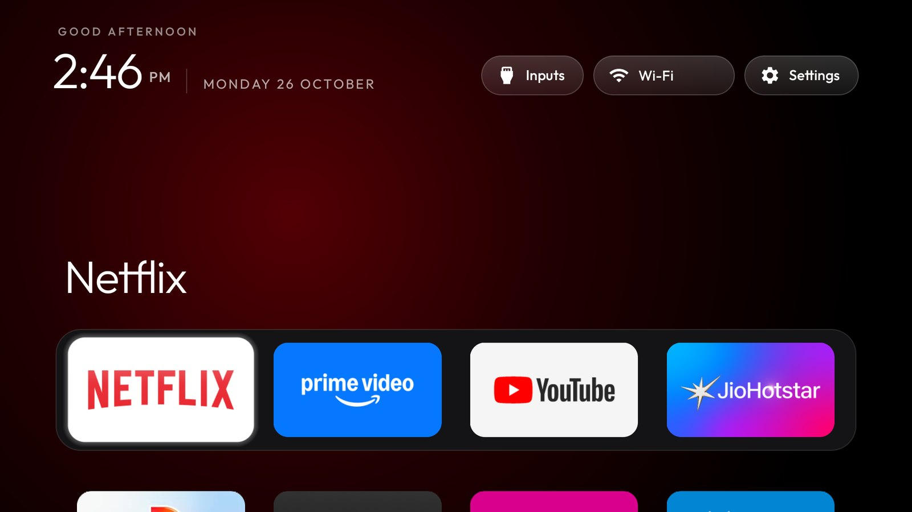
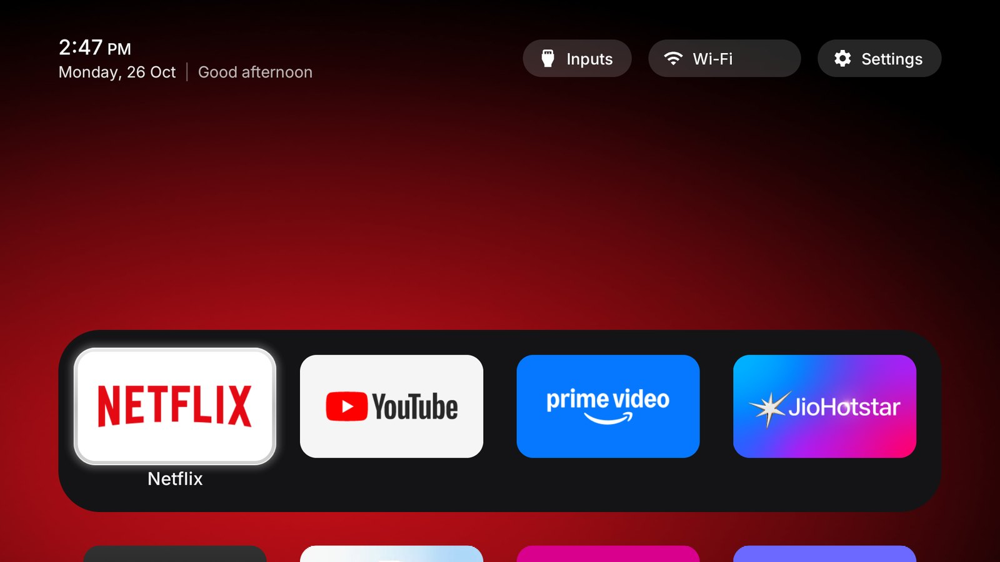

# Readable Home

A restyle of this repo's reference launcher for people of any age reading the TV from the sofa: larger and
calmer type, one spacing system for everything on screen, a clearer focus frame and a slim top bar. Built
and tested on a Xiaomi MiTV-AXSO2 (dangalUHD, Android TV 9, firmware PI.6432).

| Before (reference launcher) | After (Readable Home) |
|---|---|
|  |  |

The Wi-Fi network name is painted over in both screenshots.

## What changes, and why

### Type

Inter replaces Outfit as the only typeface. Outfit's round, wide letters looked stretched at TV distance;
Inter is narrower and made for screens. It goes through upstream's font lookup (`values/fonts.xml` and
`UiFont`), so Vietnamese still switches to the system font. It is also the default font of every launcher
theme, which means screens that never named a font (Launcher settings, Quick settings, the clock
screensaver) use it too. The font resources are renamed `inter_*`.

The font ships as `res/font/inter.ttf` (SIL Open Font License, `launcher/FONT-LICENSE-INTER-OFL.txt`). It
was cut down with fontTools to the characters Outfit covered, the text features the launcher needs (kern,
mark, mkmk, ccmp, locl, calt), no glyph names or hinting, and the weight axis from 200 to 500 only. That
makes it 123 KB, against Outfit's 110 KB. Other scripts fall back to the system font as before.

There is no letter spacing anywhere. The greeting (22% tracking) and the date (14%) used to be spaced-out
capitals; every `letterSpacing` in layouts, styles and code is gone, and text is in sentence case.

Every layout uses five text sizes from `res/values/type.xml`. Display sizes (the clocks, page titles) are
set where they are used.

| Token | sp | Used for |
|---|---|---|
| `text_caption` | 13 | small status ("On Home"), card captions (were 10 to 12) |
| `text_label` | 15 | buttons, menu rows, the date line, hints |
| `text_body` | 17 | tile names, settings rows |
| `text_title` | 20 | the time in the top bar, section titles |
| `text_headline` | 22 | dialog and library titles, the screensaver date |

Text is brighter, 70 to 100% white instead of 55 to 65%. Every tile has its name underneath, dimmed until
the tile is focused (`always_show_names`), so nobody has to recognise an app by its artwork alone. Names
scale with the tile at 6 or 8 columns and never go below 13sp. A focused name too long for its tile, such as
a module card's "Weather · Forecast …", scrolls once, as on Android TV.

### One spacing system (8dp grid)

| Element | Rule | dp |
|---|---|---|
| Content edge (top bar, dock edge) | 7 × 8 | 56 |
| Gap between tiles, across and down | 4 × 8 | 32 |
| Dock padding, all four sides (was 14 top, 22 sides) | 3 × 8 | 24 |
| Tile (16:9) | 4w + 3 × 32 = 800 − 2 × 24 | 176 × 99 |
| Tile corner | 2 × 8 | 16 |
| Dock corner, concentric | 16 + 24 | 40 |
| Buttons | height 36, radius = height / 2 | 36 / 18 |
| Inputs menu | rows 16 + padding 8 | 24 |
| Icons (top bar, Quick settings, app library) | | 20 |

Nested rounded shapes use concentric corners (outer radius = inner radius + the padding between them), so
their curves run parallel. The top bar, the dock edge and the last button share the same left and right
lines.

### Focus

The old highlight was a frosted panel drawn over the focused tile, and it washed the tile out. The new one
is a 4dp glass band around the tile: brightest at the top, with a highlight on its outer edge, a faint sheen
over the top 40% of the tile only, and a soft dark line outside so it still shows on white tiles. It overlaps
the tile by 1dp so sub-pixel placement can't open a seam, and its corners are concentric with the tile's. It
is drawn once into the existing hardware layer, so moving it costs the same as before. There is no blur:
Android 9 has no live blur, and the repo rules exclude it anyway.

The zoom is 6% instead of 10%, with a smooth ease-out instead of an overshoot, and the name under the tile no
longer slides down 10dp on focus. Together these stopped the row from appearing to jump.

Buttons turn solid white with dark text on focus and have no outline at rest. The dock band lost its 1dp
outline too: it was clipped at the grid's edge and showed as a stray vertical line on the TV.

### Top bar

The clock block was about three times the height of the buttons. It is now 48dp: the time on line 1, then
`Thursday, 22 Oct | Good afternoon` on line 2 (baseline-aligned; the divider is a glyph in the same font),
with the 36dp buttons centred on it.

The big app name above the dock is off (`dock_title`), and the dock sits one 32dp gap under the top bar
instead of at the bottom of the screen, so a full second row of apps shows on Home.

Rows scrolling up are still cut at the grid's edge, as in the reference launcher. A fading edge there was
tried and measured with `tools/bench.py --keys 36 --series 3`: janky frames went from 1 in 2,819 (0.04%) to
400 in 2,805 (14.3%) and the median key response from 23 to 31 ms, so it is not in this branch.

### Menus, library and screensaver

The Inputs menu, the Settings menu, Quick settings, the app library and the module card prompt were 95%
opaque, enough for bright text underneath to ghost through. Native Android TV menus are solid when there is
no blur, and these now are too, with no outlines at rest.

In the app library, cards and their focus frame share 16dp corners (they were 18 and 20), cards have no
outline, and the hint, count, names and status use the type scale (they were 11 to 15sp). The clock
screensaver uses Inter and shows the date in sentence case at 22sp instead of spaced capitals.

### Backgrounds on a big screen

The glow behind the apps was a 480x270 mask stretched 4x. It is now 960x540, with a one-step grain added
once when it is built, so an 8-bit panel shows a smooth fade instead of flat bands. The average flat run
along a row went from 18px to 4px. The cinematic shelf's scrim gets the same treatment.

Wallpapers are decoded in full colour on TVs with 1.5 GB of RAM or more, because 16-bit colour turned dark
gradients into steps. On the Aurora wallpaper the widest flat band went from 127-176px to 12-31px. Low-RAM
TVs keep 16-bit unless a theme sets `wallpaper_true_color`.

App banners are requested at xxhdpi when the zoomed tile is wider than an xhdpi banner (373px against 320px
on a 1080p TV). Apps that ship sharper artwork get it; others get their best, as before.

### Themes, switches and add-ons

Nothing was removed, and every key in `themes/README.md` still works. On the TV I checked the themes in
`themes/` and test themes for `dock_title`, `cinematic_home`, `icon_only_buttons` with `show_stats`,
`dock_row: false`, a festive skin with `app_glow`, `app_library` with `library_button`, 8 columns with
`rows_below_dock` 2, `dock_glass` with `sky_intensity` and `glow_style: horizon`, and
`home_idle_clock_minutes`. Three problems turned up and are fixed: the plain grid's names collided with the
next row, names were cut off at 8 columns, and the slim top bar undercut the app library's room above the
dock.

Module cards use the same contract as upstream. The Weather and Capacity Stats add-ons from `addons/` were
built, installed and shown as cards on Home, then removed again. A focused name too long for its tile was
checked with a theme's `app_labels` giving Netflix a long name: it scrolls once and returns to the shortened
name when focus moves on.

## Settings for this TV (`config.xml`)

`dock_apps` (Netflix, YouTube, Prime Video, JioHotstar), `live_tv_package` and `hidden_apps` set to
`com.android.tv` as `examples/xiaomi-mitv-axso2` says, `rows_below_dock` 1, `dock_title` false,
`always_show_names` true and `focus_overshoot` false. Change them for your own set.

## Size and performance

The release APK is 481,163 bytes, against 481,243 for the reference launcher at the same upstream commit
(80 bytes smaller) and under the repo's 491,520-byte size gate. There are no new views on the hot path, no
blur and no added animation. The focus frame draws fewer primitives than the old glass (no fill, no 12 glow
rings), and the header change only rearranges existing text views.

## Tests

`TileFitTest` pins the grid's geometry. Its screen numbers now follow this layout (a grid 1664px wide and
900px tall at 1080p), the dock title reserves 88dp instead of 104dp, and the plain grid's check accepts
tiles a little under the width limit but never under the floor. All launcher unit tests pass, lint reports
no errors, and the Python suite passes. Two `test_device_notes_index` cases failed on macOS on upstream `main` too; the
fix is on this branch and in upstream PR #924.

## Screenshots

Every launcher screenshot on this branch is new, taken on the Xiaomi MiTV-AXSO2 with the Wi-Fi network name
painted over: the README's six (`docs/focus-2-up-netflix.png`, `docs/focus-1-fancode.png`,
`docs/inputs-menu.jpg`, `docs/clock-screensaver.png`, `docs/tile-move.jpg`, `docs/app-library.jpg`) and
the six themes' `screenshot.jpg`, at the original 1280x720.

## Hebrew

`layout-iw` mirrors the new header: the 48dp block sits on the right with the time on line 1 (AM/PM to its
left) and `date | greeting` reading right to left on line 2, and the buttons are centred on it. Android 9
cannot switch one app's language from the shell, so it was checked on the TV with a build that used the
Hebrew layout for every language.

## Build

Same as the reference launcher: `TV_HOST=<tv ip> launcher/build-and-install.sh`.
