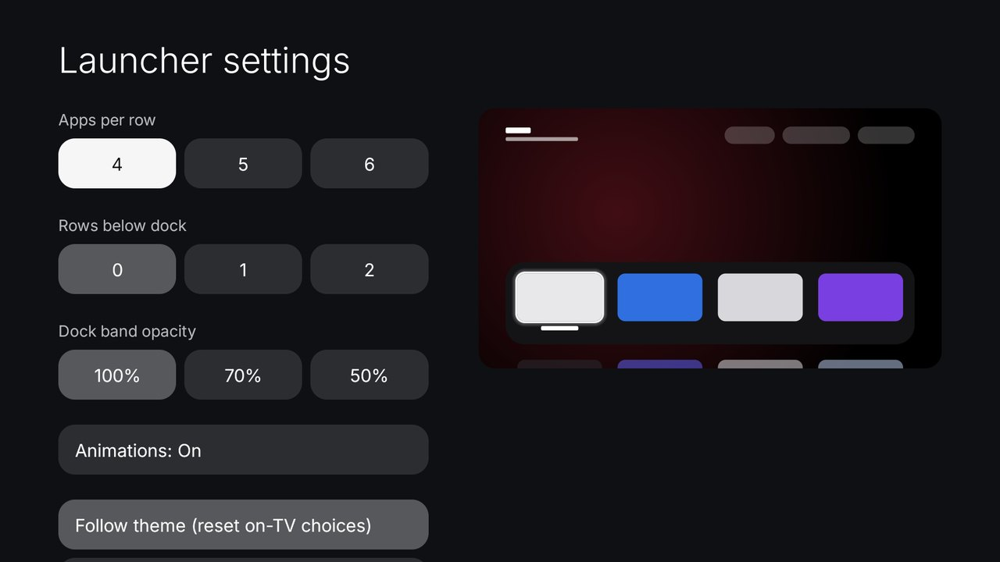
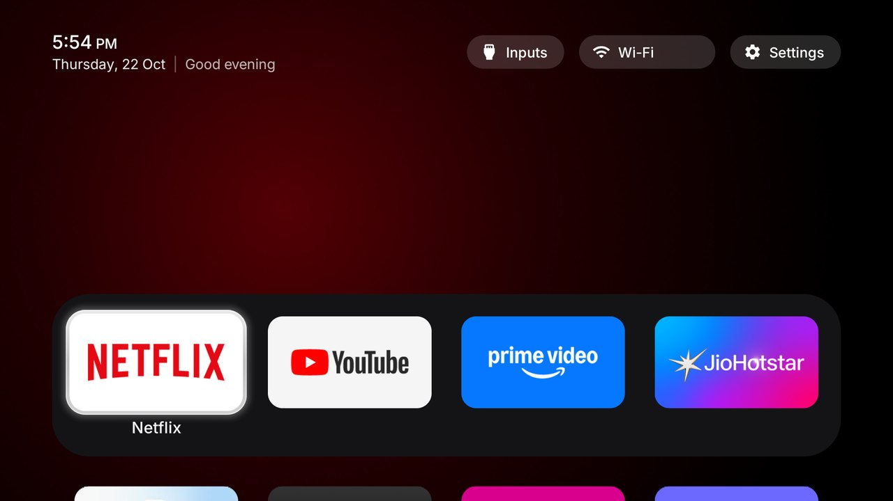
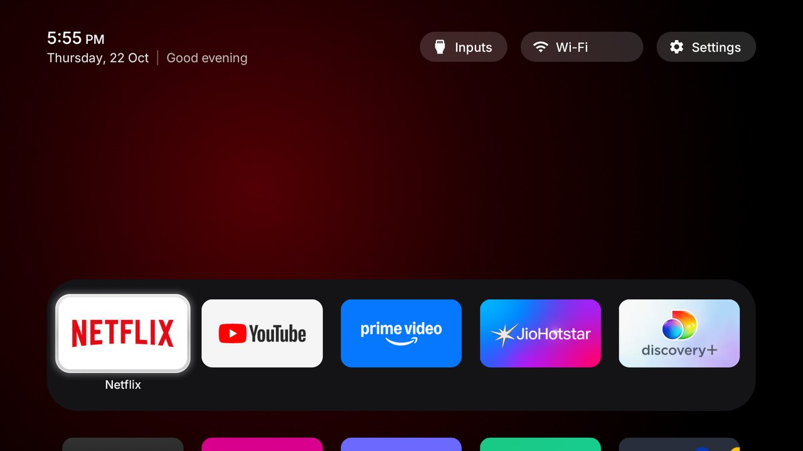
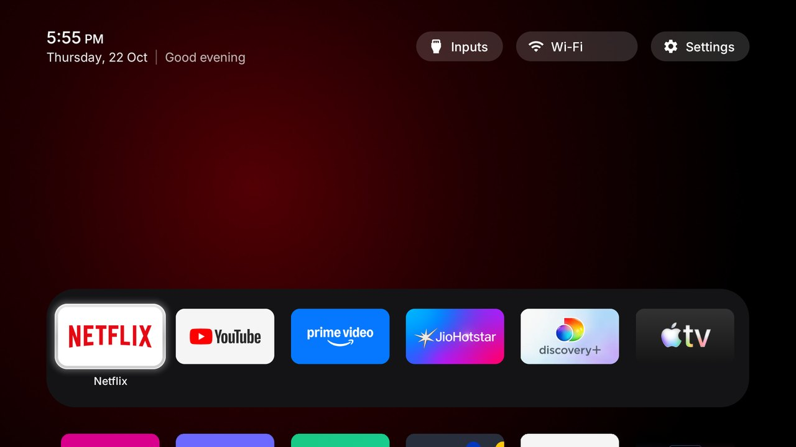
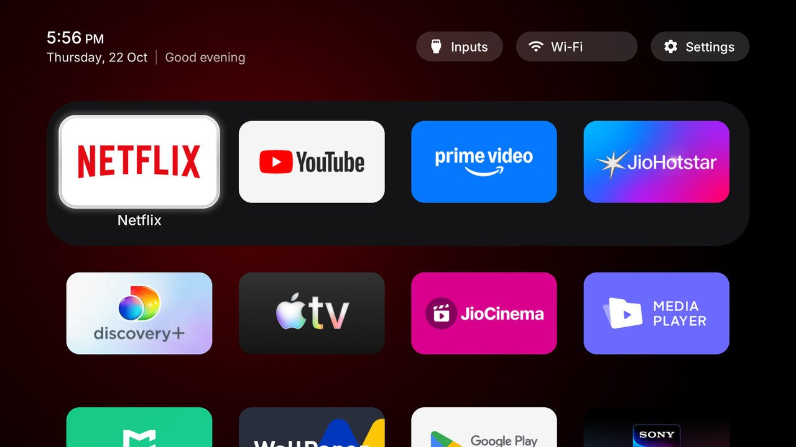
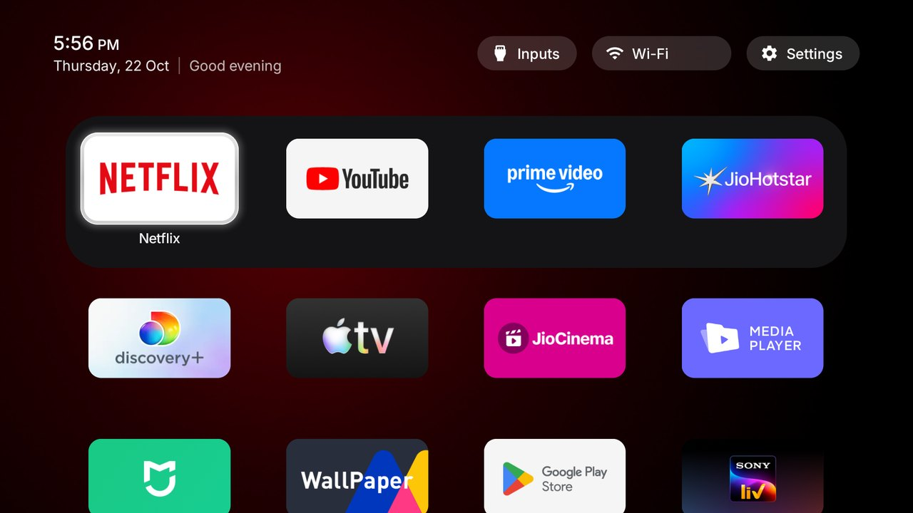
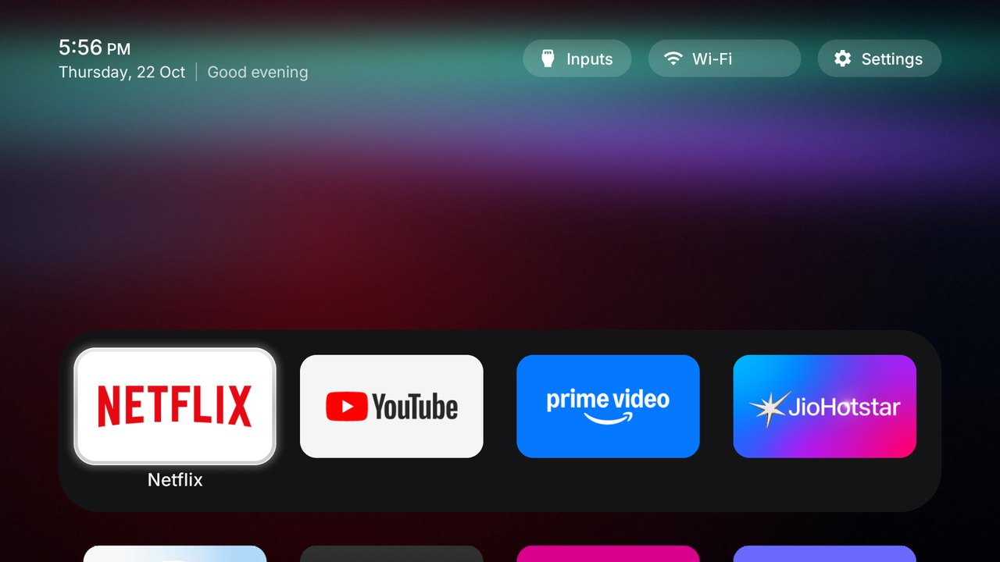
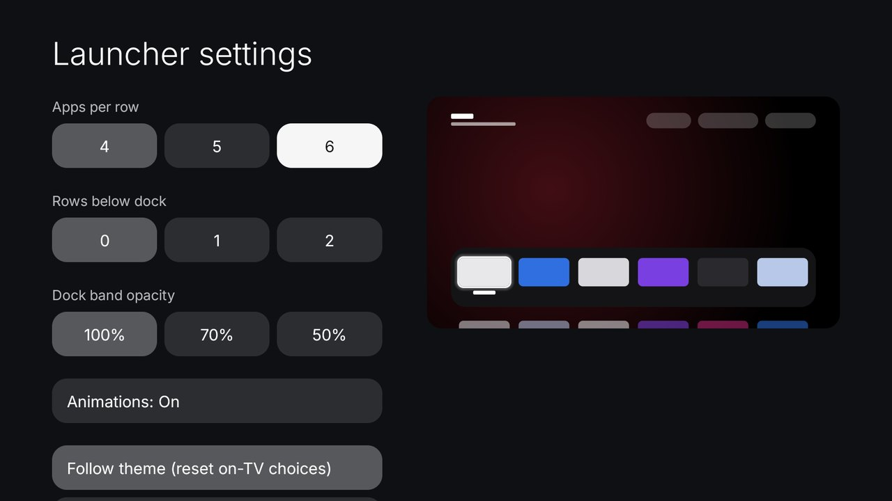
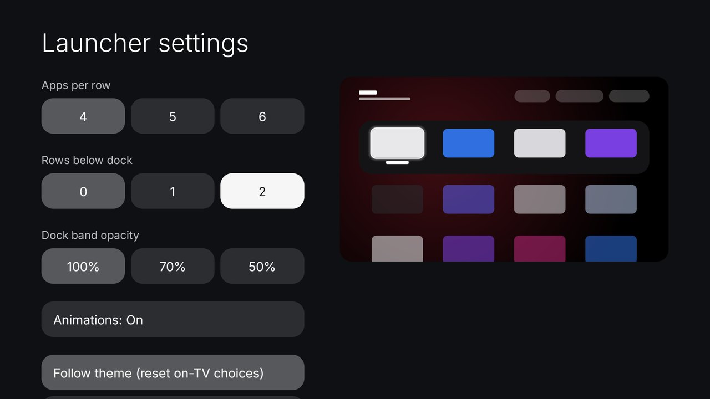
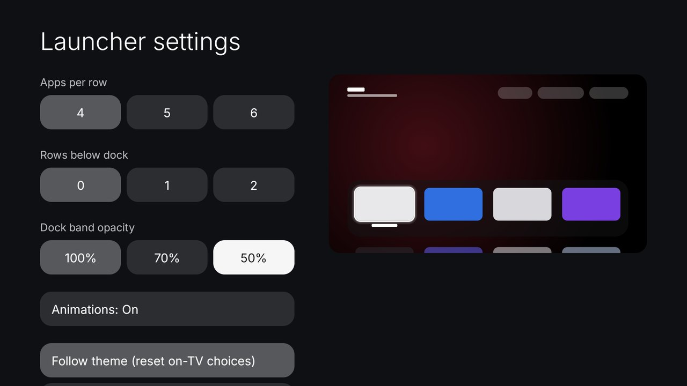

# Readable Home

A restyle of this repo's launcher for people of any age reading the TV from the sofa: larger and calmer type,
one spacing system for everything on screen, a clear focus frame and a slim top bar. Everything else works as
in the reference launcher: themes, module cards, the app library, the Inputs menu, the remote buttons.

Built and tested on a Xiaomi MiTV-AXSO2 (dangalUHD, Android TV 9, firmware PI.6432). Every screenshot on this
page was taken on that TV, with the Wi-Fi network name painted over.

| Before (reference launcher) | After (Readable Home) |
|---|---|
|  |  |

## What you see on Home

| Part | What it is | What the remote does |
|---|---|---|
| Top bar, left | The time, then the date and a greeting | Nothing to select |
| Top bar, right | Inputs, the Wi-Fi network, Settings | Up from the dock. OK opens; hold OK on Settings for the launcher's own menu |
| Dock | Your favourite apps in a dark band | Left and Right move between them, OK opens |
| Grid | Every other app, in the same order as the app list | Down from the dock; Down and Up move a row at a time |
| Focus frame | A white glass frame with a soft glow around the app you are on; its name appears underneath | Follows the arrows |

Only the app you are on shows its name, so the screen stays quiet; set `always_show_names` in a theme to name
every tile.

## Install

Same as the reference launcher. With the TV on the same network and network debugging on:

```bash
git clone -b readable-home https://github.com/itismowgli/cleanyourtv
cd cleanyourtv
TV_HOST=<tv ip> launcher/build-and-install.sh
```

Your dock and hidden apps go in `launcher/app/src/main/res/values/config.xml` before you build, or in a
theme afterwards (`themes/README.md`).

## Launcher settings

Hold OK on **Settings** in the top bar, then choose **Launcher settings**. The page keeps to the choices that
cannot make Home look broken. On the right, a sketch of Home shows the choice you are on before you press OK,
so you can look before you change anything. **Follow theme** puts every choice back.



### Apps per row

How many apps sit in each row. More apps per row means smaller tiles. 4 suits most living rooms.

| 4 | 5 | 6 |
|---|---|---|
|  |  |  |

### Rows below dock

How much of the app grid shows under the dock without pressing Down. 0 keeps the dock low with the screen
calm above it; 1 lifts the dock under the top bar with a row of apps below; 2 makes the tiles a little smaller
so two rows fit.

| 0 | 1 | 2 |
|---|---|---|
|  |  |  |

### Dock band opacity

How solid the dark band behind the dock is. It only makes a difference with a wallpaper, which shows through
at 70% and 50% (these three use the Aurora theme's wallpaper).

| 100% | 70% | 50% |
|---|---|---|
|  |  |  |

### Animations

On by default: the focus frame glides and the focused tile grows a little. Off, both jump straight to the
next app, which helps on slow TVs. Home looks the same either way when nothing is moving, so there is no
picture for this one.

### The sketch follows your choice

| Apps per row on 6 | Rows below dock on 2 | Dock band on 50% |
|---|---|---|
|  |  |  |

### Not on this page

Seven apps per row, three rows, a 30% dock band and advanced effects still work, from a theme's
`config.json` (keys in `themes/README.md`). They are left off the page because they are easy to get wrong
from the sofa.

## What changed, and why (for contributors)

### Type

Inter replaces Outfit as the only typeface. Outfit's round, wide letters looked stretched at TV distance;
Inter is narrower and made for screens. It goes through upstream's font lookup (`values/fonts.xml` and
`UiFont`), so Vietnamese still switches to the system font. It is also the default font of every launcher
theme, which means screens that never named a font (Launcher settings, Quick settings, the clock
screensaver) use it too. The font resources are renamed `inter_*`.

The font ships as `res/font/inter.ttf` (SIL Open Font License, `launcher/FONT-LICENSE-INTER-OFL.txt`). It
was cut down with fontTools to the characters Outfit covered, the text features the launcher needs (kern,
mark, mkmk, ccmp, locl, calt), no glyph names or hinting, and the weight axis from 200 to 500 only. That
makes it 123 KB, against Outfit's 110 KB. Other scripts fall back to the system font as before.

There is no letter spacing anywhere. The greeting (22% tracking) and the date (14%) used to be spaced-out
capitals; every `letterSpacing` in layouts, styles and code is gone, and text is in sentence case.

Every layout uses five text sizes from `res/values/type.xml`. Display sizes (the clocks, page titles) are
set where they are used.

| Token | sp | Used for |
|---|---|---|
| `text_caption` | 13 | small status ("On Home"), card captions (were 10 to 12) |
| `text_label` | 15 | buttons, menu rows, the date line, hints |
| `text_body` | 17 | tile names, settings rows |
| `text_title` | 20 | the time in the top bar, section titles |
| `text_headline` | 22 | dialog and library titles, the screensaver date |

Text is brighter, 70 to 100% white instead of 55 to 65%. The focused tile shows its name underneath, in
the dock too now that the big title above the dock is off; `always_show_names` still shows every name.
Names scale with the tile at 6 or 8 columns and never go below 13sp. A focused name too long for its tile, such as
a module card's "Weather · Forecast …", scrolls once, as on Android TV.

### One spacing system (8dp grid)

| Element | Rule | dp |
|---|---|---|
| Content edge (top bar, dock edge) | 7 × 8 | 56 |
| Gap between tiles, across and down | 4 × 8 | 32 |
| Dock padding, all four sides (was 14 top, 22 sides) | 3 × 8 | 24 |
| Tile (16:9) | 4w + 3 × 32 = 800 − 2 × 24 | 176 × 99 |
| Tile corner | 2 × 8 | 16 |
| Dock corner, concentric | 16 + 24 | 40 |
| Buttons | height 36, radius = height / 2 | 36 / 18 |
| Inputs menu | rows 16 + padding 8 | 24 |
| Icons (top bar, Quick settings, app library) | | 20 |

Nested rounded shapes use concentric corners (outer radius = inner radius + the padding between them), so
their curves run parallel. The top bar, the dock edge and the last button share the same left and right
lines.

### Focus

The old highlight was a frosted panel drawn over the focused tile, and it washed the tile out. The new one
is a 4dp glass band around the tile: brightest at the top, with a highlight on its outer edge, a faint sheen
over the top 40% of the tile only, and a slight glow fading out over 10dp around it. It overlaps
the tile by 1dp so sub-pixel placement can't open a seam, and its corners are concentric with the tile's. It
is drawn once into the existing hardware layer, so moving it costs the same as before. There is no blur:
Android 9 has no live blur, and the repo rules exclude it anyway.

The zoom is 6% instead of 10%, with a smooth ease-out instead of an overshoot, and the name under the tile no
longer slides down 10dp on focus. Together these stopped the row from appearing to jump.

Buttons turn solid white with dark text on focus and have no outline at rest. The dock band lost its 1dp
outline too: it was clipped at the grid's edge and showed as a stray vertical line on the TV.

### Top bar

The clock block was about three times the height of the buttons. It is now 48dp: the time on line 1, then
`Thursday, 22 Oct | Good afternoon` on line 2 (baseline-aligned; the divider is a glyph in the same font),
with the 36dp buttons centred on it.

The big app name above the dock is off (`dock_title`), and the dock sits 48dp under the top bar instead of
at the bottom of the screen, so a full second row of apps shows on Home.

Rows scrolling up are still cut at the grid's edge, as in the reference launcher. A fading edge there was
tried and measured with `tools/bench.py --keys 36 --series 3`: janky frames went from 1 in 2,819 (0.04%) to
400 in 2,805 (14.3%) and the median key response from 23 to 31 ms, so it is not in this branch.

### Menus, library and screensaver

The Inputs menu, the Settings menu, Quick settings, the app library and the module card prompt were 95%
opaque, enough for bright text underneath to ghost through. Native Android TV menus are solid when there is
no blur, and these now are too, with no outlines at rest.

In the app library, cards and their focus frame share 16dp corners (they were 18 and 20), cards have no
outline, and the hint, count, names and status use the type scale (they were 11 to 15sp). The clock
screensaver uses Inter and shows the date in sentence case at 22sp instead of spaced capitals.

### Launcher settings

The page keeps a short list: apps per row (4, 5, 6), rows below the dock (0, 1, 2), dock band opacity (100%,
70%, 50%), the wallpaper picker (only when a theme has pictures), animations, and the reset, default home and
TV settings rows. The extremes (7 per row, 3 rows, a 30% dock) and advanced effects stay theme keys. On the
right a block sketch of Home (`SettingsPreview`) draws the layout with the launcher's own tile sizing, and it
shows the choice under focus before it is pressed. Choices look like the rest of the launcher: white with dark
text when focused, a lighter fill when chosen, no outlines. No new strings.

### Backgrounds on a big screen

The glow behind the apps is a 480x270 mask stretched 4x. A one-step grain is now added once when it is
built, so an 8-bit panel shows a fade instead of flat bands: the average flat run along a row went from 18px
to 7px. (A 960x540 mask got it to 4px, but cost memory and start-up time, so the mask stays at 480x270.)
The cinematic shelf's scrim gets the same grain.

Wallpapers are decoded in full colour on TVs with 1.5 GB of RAM or more, because 16-bit colour turned dark
gradients into steps. On the Aurora wallpaper the widest flat band went from 127-176px to 12-31px. Low-RAM
TVs keep 16-bit unless a theme sets `wallpaper_true_color`.

### Themes, switches and add-ons

Nothing was removed, and every key in `themes/README.md` still works. On the TV I checked the themes in
`themes/` and test themes for `dock_title`, `cinematic_home`, `icon_only_buttons` with `show_stats`,
`dock_row: false`, a festive skin with `app_glow`, `app_library` with `library_button`, 8 columns with
`rows_below_dock` 2, `dock_glass` with `sky_intensity` and `glow_style: horizon`, and
`home_idle_clock_minutes`. Three problems turned up and are fixed: the plain grid's names collided with the
next row, names were cut off at 8 columns, and the slim top bar undercut the app library's room above the
dock.

Module cards use the same contract as upstream. The Weather and Capacity Stats add-ons from `addons/` were
built, installed and shown as cards on Home, then removed again. A focused name too long for its tile was
checked with a theme's `app_labels` giving Netflix a long name: it scrolls once and returns to the shortened
name when focus moves on.

## Settings for this TV (`config.xml`)

`dock_apps` (Netflix, YouTube, Prime Video, JioHotstar), `live_tv_package` and `hidden_apps` set to
`com.android.tv` as `examples/xiaomi-mitv-axso2` says, `rows_below_dock` 0, `dock_title` false,
`always_show_names` false and `focus_overshoot` false. Change them for your own set.

## Size and performance

The release APK is 481,119 bytes, against 481,243 for the reference launcher at the same upstream commit,
under the repo's 491,520-byte size gate. `tools/bench.py --keys 36 --series 3` on the TV:

| | Key response p50 / p95 | Janky frames | Cold start | Memory (PSS) |
|---|---|---|---|---|
| Reference launcher (`main`) | 23 / 32 ms | 0.02% | 652 ms | 19 MB |
| This branch | 23 / 32 ms | 0.7% (15 of 2,151) | 693 ms | 38 MB |

Where the extra memory goes has not been traced yet. An earlier version with 960x540 glow masks and xxhdpi
banners used 41 MB and started in 905 ms, so both were taken back out. There are no new views on the hot
path and no blur.

## Tests

`TileFitTest` pins the grid's geometry. Its screen numbers now follow this layout (a grid 1664px wide and
900px tall at 1080p), the dock title reserves 88dp instead of 104dp, and the plain grid's check accepts
tiles a little under the width limit but never under the floor. All launcher unit tests pass, lint reports
no errors, and the Python suite passes. Two `test_device_notes_index` cases failed on macOS on upstream `main` too; the
fix is on this branch and in upstream PR #924.

## Screenshots

Every screenshot is new, taken on the Xiaomi MiTV-AXSO2 with this build and the Wi-Fi network name painted
over: the README's six (`docs/focus-2-up-netflix.png`, `docs/focus-1-fancode.png`, `docs/inputs-menu.jpg`,
`docs/clock-screensaver.png`, `docs/tile-move.jpg`, `docs/app-library.jpg`), the six themes'
`screenshot.jpg` at 1280x720, and the settings set in `settings/`, each pushed as a one-key theme so the value
shown is exact.

## Hebrew

`layout-iw` mirrors the new header: the 48dp block sits on the right with the time on line 1 (AM/PM to its
left) and `date | greeting` reading right to left on line 2, and the buttons are centred on it. Android 9
cannot switch one app's language from the shell, so it was checked on the TV with a build that used the
Hebrew layout for every language.
